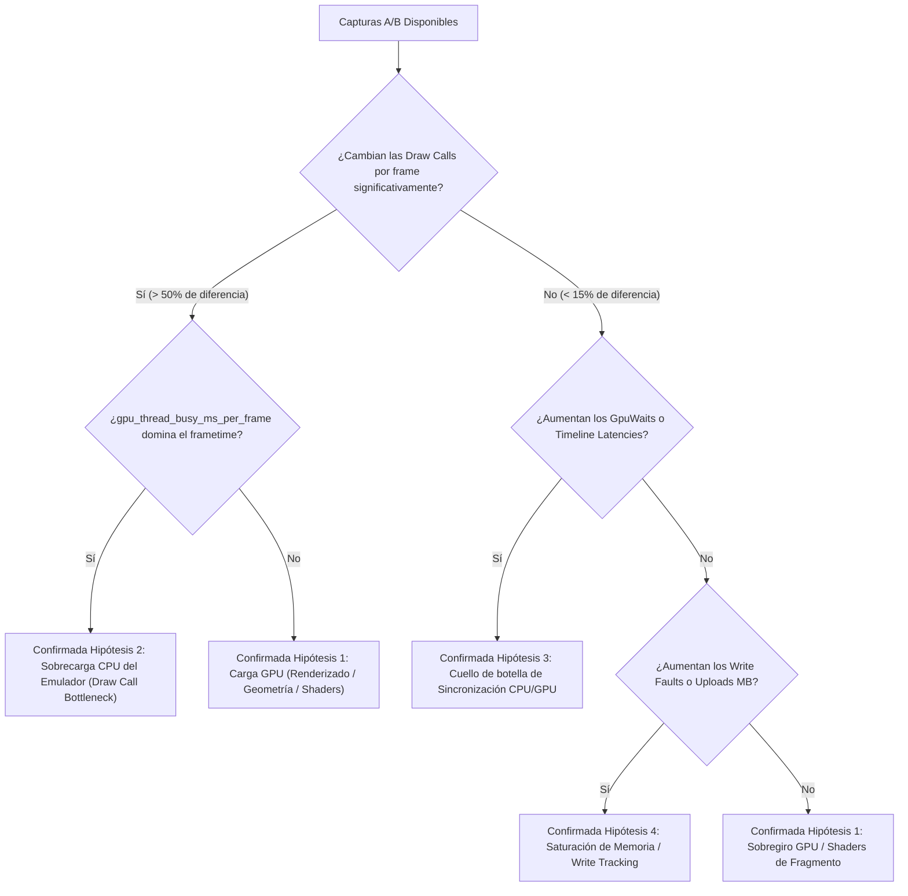

# KytyPS5 — Etapa 6.1: Plan de Diagnóstico de Cuellos de Botella Gráficos

Este documento define el marco analítico, las cinco hipótesis competitivas y la matriz de decisión para interpretar los datos de la prueba A/B de cámara (Vista Amplia vs Vista Reducida) en Astro Bot (`PPSA21567`).

---

## 1. Las Cinco Hipótesis del Rendimiento Gráfico

Cuando la cámara de Astro Bot pasa de enfocar el horizonte amplio a enfocar el suelo, el rendimiento aumenta considerablemente. Las siguientes cinco hipótesis explican los posibles mecanismos causales:

### Hipótesis 1 — Carga GPU (Rasterización, Shading y Overdraw)
- **Mecanismo:** La vista amplia muestra múltiples capas de geometría lejana, niebla volumétrica, reflejos, efectos de partículas y sombreado complejo. El GPU del host (NVIDIA RTX 5080) se ve saturado en unidades de sombreado (ALUs/ROPs) o ancho de banda de memoria por sobregiro (overdraw).
- **Indicadores Clave:**
  - El frametime disminuye drásticamente en la vista reducida.
  - La cantidad de draw calls o el tiempo de CPU del hilo GPU (`gpu_thread_busy_ms`) **no** disminuyen en la misma proporción que el frametime total.
  - Las esperas en semáforos de timeline o en el flip completion reflejan que el GPU tarda menos en vaciar su cola de ejecución.

### Hipótesis 2 — Sobrecarga CPU del Emulador (Traducción de Comandos y Draw Calls)
- **Mecanismo:** El emulador debe decodificar cada paquete PM4 de AGC, validar los descriptores de Vulkan, actualizar el estado dinámico y emitir llamadas de dibujo (`vkCmdDraw*`). Una escena amplia con muchos objetos genera cientos o miles de llamadas de dibujo por cuadro, saturando el hilo de CPU del emulador.
- **Indicadores Clave:**
  - `total_draws` y `draws_per_frame` son sustancialmente mayores en la vista amplia.
  - `gpu_thread_busy_ms_per_frame` (tiempo de CPU en `graphicsRun.cpp`) es alto en la vista amplia y cae drásticamente en la vista reducida.
  - El frametime total sigue de cerca el tiempo de CPU dedicado a procesar comandos.

### Hipótesis 3 — Sincronización CPU/GPU y Esperas de Bloqueo
- **Mecanismo:** La escena amplia contiene elementos dinámicos que fuerzan esperas de sincronización (por ejemplo, consultas de oclusión, lectura de metadatos de color DCC o sincronización de búferes de transformación).
- **Indicadores Clave:**
  - Aumento significativo en `GpuWaitThreadMs` en categorías como `BufferReadback`, `TextureWriteBack` u `OcclusionQueries`.
  - Disparidad entre el tiempo de cálculo activo y el tiempo de bloqueo en semáforos.

### Hipótesis 4 — Transferencias de Memoria y Write Tracking
- **Mecanismo:** Mayor visibilidad de objetos activos genera mayor volumen de escrituras por parte de la CPU del guest en búferes dinámicos de vértices y parámetros de instancias, provocando ráfagas de fallos de página (`GpuFaults`) y reprotecciones.
- **Indicadores Clave:**
  - `total_faults` y `faults_per_frame` se incrementan en vista amplia.
  - `cpu_to_gpu_upload_bytes` aumenta notablemente debido a mayor volumen de búferes modificados.

### Hipótesis 5 — Trabajo Adicional de la CPU Guest (Lógica y Culling del Juego)
- **Mecanismo:** La CPU del guest debe evaluar visibilidad (frustum culling, occlusion culling), actualizar árboles de animación y calcular físicas para más actores visibles, tardando más tiempo en el hilo del juego antes de someter los comandos a AGC.
- **Indicadores Clave:**
  - El tiempo entre la finalización de un flip y el sometimiento del siguiente (`FlipQueue::Reserve`) es significativamente mayor en vista amplia, sin que el GPU esté saturado.

---

## 2. Matriz de Decisión Diagnóstica

Una vez que el usuario proporcione las capturas `stage6_1_camera_wide.json` y `stage6_1_camera_ground.json`, se aplicará la siguiente matriz de evaluación:

---

## 3. Verificación de la Relación entre FPS y Velocidad de Simulación

Para responder a la pregunta fundamental de si la velocidad de simulación está rígidamente vinculada a los FPS:

1. **Comparación de Ratios:**
   Se contrastará la relación de FPS entre ambas pruebas frente a la relación de frecuencia de flips:
   $$\text{Ratio FPS} = \frac{\text{FPS}_{\text{ground}}}{\text{FPS}_{\text{wide}}}, \quad \text{Ratio Flips} = \frac{\text{flip\_rate}_{\text{ground}}}{\text{flip\_rate}_{\text{wide}}}$$
2. **Evaluación de Pacing:**
   - Si $\text{Ratio FPS} \approx \text{Ratio Flips}$, se demuestra que la tasa a la que el juego somete y completa cuadros escala directamente con la fluidez del renderizado.
   - Si la velocidad aparente percibida por el usuario en la vista reducida (suelo) es significativamente más rápida (normalizándose hacia velocidad real), se confirmará experimentalmente la hipótesis del acoplamiento por `FlipEvent`.
3. **Comportamiento del Audio:**
   Se verificará que `audio_effective_hz` se mantenga constante en $\sim 48.000\text{ Hz}$ en ambas capturas, ratificando la independencia del hilo de sonido.

---

## 4. Hoja de Ruta para Etapas Posteriores según el Resultado

| Resultado del Diagnóstico | Cuello de Botella Identificado | Optimización Candidata para Siguientes Etapas |
|---|---|---|
| **Draw Calls / CPU Overhead Dominante** | Hipótesis 2 | Agrupamiento de llamadas de dibujo (MultiDrawIndirect), reducción de redundancia en cambios de estado dinámico de Vulkan, bypass de validación en descriptores inmutables. |
| **Carga de Sombreadores / GPU Dominante** | Hipótesis 1 | Optimización del recompilador de shaders SPIR-V, simplificación de ramas divergentes, reducción de resolución interna de renderizado (FSR / PSSR). |
| **Sincronización Dominante** | Hipótesis 3 | Afinación del intervalo de Submit Cadence, desbloqueo asíncrono de fences de presentación, pipelining de consultas de oclusión. |
| **Write Faults / Memoria Dominante** | Hipótesis 4 | Coalescencia expandida de rangos de desprotección, seguimiento selectivo por página en búferes estáticos, reciclaje agresivo de búferes de streaming. |
