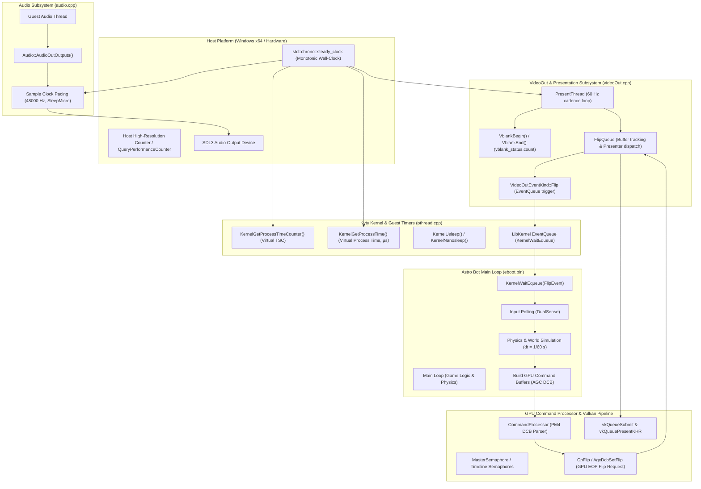

# KytyPS5 — Etapa 6: Arquitectura de Temporización y Sincronización

Este documento describe la arquitectura integral de temporización, relojes, colas de eventos y sincronización multihilo de KytyPS5, analizando el flujo desde el reloj de pared del host hasta la presentación gráfica y la reproducción de audio en Astro Bot (`PPSA21567`).

---

## 1. Diagrama de Arquitectura de Temporización

---

## 2. Subsistemas de Temporización

### 2.1. Reloj de Pared del Host y Relojes del Guest
El emulador mapea todos los relojes del guest directamente contra el reloj de pared de alta precisión del host (`Common::SteadyNs()`, respaldado por `QueryPerformanceCounter` en Windows):

1. **`KernelGetProcessTime()`**:
   - Devuelve microsegundos transcurridos desde el inicio del proceso:
     $$\text{processTime} = \frac{\text{Common::SteadyNs}() - \text{g\_boot\_time\_ns}}{1000}$$
   - Es estrictamente monótono y avanza a velocidad $1.0\times$ (tiempo real).

2. **`KernelGetProcessTimeCounter()`**:
   - Devuelve ticks virtuales basados en la frecuencia nominal reportada por `KernelGetProcessTimeCounterFrequency()` ($1\text{ GHz}$ o frecuencia del TSC del host).
   - Avanza exactamente en proporción con el tiempo transcurrido en el host.

3. **`KernelUsleep()` / `KernelNanosleep()`**:
   - Utilizan primitivas de espera de alta resolución del host (`Common::Thread::SleepMicro` / `SleepNano`).

### 2.2. Hilo de Presentación y Generador de VBlank
En [src/graphics/presentation/videoOut.cpp](file:///c:/Users/Recko/Documents/github/kyty/src/graphics/presentation/videoOut.cpp), `PresentThread` ejecuta un bucle continuo de temporización de display:
- **Frecuencia objetivo:** $60\text{ Hz}$ nominal (`Config::GetVblankFrequency()`, periodo $T = 16.666\text{ ms}$).
- En cada iteración:
  1. Invoca `VblankBegin()`.
  2. Invoca `m_flip_queue.Flip()`, que evalúa si hay un frame del GPU listo para presentar (`due == true`).
  3. Si no hay frame listo pero la superposición del sistema lo requiere, refresca el último frame.
  4. Invoca `VblankEnd()`, que incrementa `ctx.vblank_status.count`, actualiza `processTime` y señaliza la variable de condición `vblank_cond`.
  5. Calcula el tiempo restante del intervalo de $16.666\text{ ms}$ y duerme.

### 2.3. Cola de Flips (`FlipQueue`) y Disparo de Eventos
Astro Bot no envía flips mediante la llamada síncrona `VideoOutSubmitFlip`. En su lugar:
1. Registra un manejador de eventos de flip mediante `VideoOutAddFlipEvent(eq)`.
2. Emite los comandos de renderizado a través de la biblioteca gráfica AGC.
3. Inserta un comando de flip al final de su Command Buffer (DCB) mediante `AgcDcbSetFlip()`.
4. Cuando el GPU emulador (`CommandProcessor`) procesa el paquete PM4 correspondiente al final del frame, se invoca `FlipQueue::Reserve()` con origen `FlipRequestSource::GpuEop`.
5. El hilo `PresentThread` toma el frame en su siguiente ciclo de VBlank, llama a `vkQueuePresentKHR`, e invoca `TriggerVideoOutEvents(ctx, VideoOutEventKind::Flip)`.
6. La señalización del evento desbloquea a Astro Bot en `KernelWaitEqueue(eq)`.

### 2.4. Subsistema de Audio y Desacoplamiento de Pacing
En [src/libs/audio.cpp](file:///c:/Users/Recko/Documents/github/kyty/src/libs/audio.cpp), la función `Audio::AudioOutOutputs()` se encarga de enviar muestras de audio hacia SDL:
- Las llamadas envían bloques típicos de 256 o 512 muestras a $48000\text{ Hz}$.
- El ritmo de entrega se calcula estrictamente mediante el reloj de muestras:
  $$\text{deadline} = \text{port.clock.Advance}(\text{now}, \text{samples}, \text{freq})$$
- Si $\text{deadline} > \text{now}$, el hilo de audio duerme durante la diferencia:
  $$\Delta t = \text{deadline} - \text{now}$$
- Esto garantiza que el audio se reproduzca exactamente a velocidad $1.0\times$ (tiempo real continuo), sin importar cuántos frames por segundo genere el GPU.

---

## 3. Conclusión de la Arquitectura
El bucle principal del juego y el bucle de audio son dos hilos completamente independientes:
- **Audio:** Sincronizado contra el reloj de pared del host ($48\text{ kHz}$).
- **Video / Simulación:** Sincronizado contra la finalización de los flips del GPU a través del `FlipEvent`.
- Al renderizar a $\sim 20\text{ FPS}$, los flips tardan $\sim 50\text{ ms}$, limitando la frecuencia de actualización del juego a 20 iteraciones por segundo.
