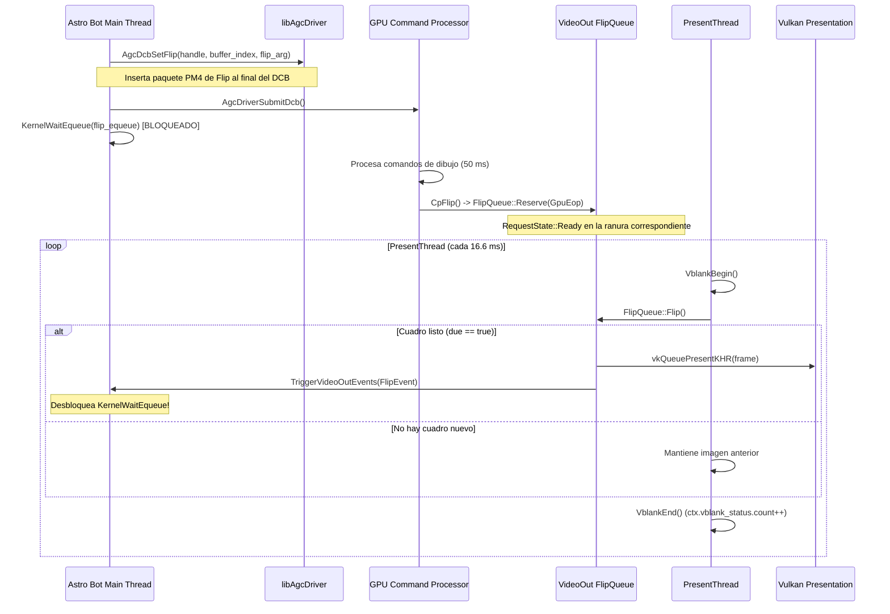

# KytyPS5 — Etapa 6: Análisis de VBlank, Presentación y Colas de Flips

Este informe analiza en profundidad la diferencia técnica entre VBlank (frecuencia de refresco de pantalla) y Presentation Flips (completitud de cuadros de renderizado), evaluando el comportamiento de `PresentThread` y `FlipQueue` ante caídas de rendimiento en Astro Bot (`PPSA21567`).

---

## 1. Distinción Conceptual: VBlank vs Presentation Flip

En la arquitectura de PlayStation 5 y en KytyPS5 existen dos conceptos de temporización visual frecuentemente confundidos:

| Concepto | Definición | Frecuencia Nominal | Comportamiento bajo Carga GPU (20 FPS) |
|---|---|:---:|---|
| **VBlank (Vertical Blanking)** | Intervalo periódico del controlador de pantalla (Display Controller) entre el fin de un escaneo de cuadro y el inicio del siguiente por el puerto HDMI. | $60.0\text{ Hz}$ ($16.666\text{ ms}$) o $120.0\text{ Hz}$ ($8.333\text{ ms}$) | Permanece a $60\text{ Hz}$ fijos en el hardware real, repitiendo el cuadro anterior si no hay uno nuevo listo. |
| **Presentation Flip** | El intercambio efectivo del búfer de pantalla (Front Buffer $\leftrightarrow$ Back Buffer) cuando el GPU ha completado el renderizado del cuadro. | Hasta $60\text{ FPS}$ (o desacoplado con VRR) | **Cae a $\sim 20\text{ FPS}$ ($49.5\text{ ms}$)** debido al costo de emulación en el GPU. |

---

## 2. Flujo de Flips en Astro Bot mediante AGC PM4 DCB

Astro Bot no utiliza llamadas CPU de alto nivel como `VideoOutSubmitFlip` para presentar sus cuadros. En su lugar:



### Detalle del Bloqueo y Desbloqueo:
1. Astro Bot llama a `VideoOutAddFlipEvent(eq)` durante su inicialización.
2. En cada iteración del bucle de juego, tras enviar los comandos al GPU, llama a `KernelWaitEqueue(eq)`.
3. El hilo permanece en estado de espera hasta que `FlipQueue::Flip()` en el hilo `PresentThread` encuentra el request con `state == RequestState::Ready`.
4. Cuando `due == true`, se invoca `TriggerVideoOutEvents(ctx, VideoOutEventKind::Flip, flip_arg)`.
5. Esto envía una señal al `KernelEqueue`, despertando al hilo de Astro Bot para comenzar el siguiente cuadro.

---

## 3. Comportamiento de `PresentThread` y Fenómeno de "Bunching" de VBlanks

En [src/graphics/presentation/videoOut.cpp](file:///c:/Users/Recko/Documents/github/kyty/src/graphics/presentation/videoOut.cpp), el bucle `PresentThread` calcula el tiempo de espera de la siguiente forma:

```cpp
void VideoOutDriver::Impl::PresentThread(std::stop_token token) {
    const auto period = Clock::duration(std::chrono::seconds(1)) / Config::GetVblankFrequency();
    std::chrono::nanoseconds total_wait {};

    while (!token.stop_requested()) {
        const auto sleep_begin = Clock::now();
        if (total_wait.count() > 0) {
            Common::Thread::SleepNano(static_cast<uint64_t>(total_wait.count()));
        }
        const auto frame_begin = Clock::now();
        total_wait -= frame_begin - sleep_begin;

        VblankBegin();
        bool presented = m_flip_queue.Flip();
        ...
        VblankEnd();

        total_wait += period - (Clock::now() - frame_begin);
        if (total_wait.count() < 0) {
            Common::DebugCounters::Add(Common::DebugCounters::Counter::LateVblanks);
        }
    }
}
```

### Análisis del Comportamiento con Cuadros Lentos (50 ms):
1. **Cuadro presentado:** Si `m_flip_queue.Flip()` o la llamada de presentación tarda $50\text{ ms}$, el término `Clock::now() - frame_begin` resulta ser $50\text{ ms}$.
2. **Déficit acumulado:** Con `period` igual a $16.666\text{ ms}$, `total_wait` sufre una reducción neta de $16.666 - 50 = -33.333\text{ ms}$.
3. **Iteraciones inmediatas ("Bunching"):**
   - En la siguiente vuelta del bucle, `total_wait.count() > 0` es falso. El hilo **no duerme**.
   - Se ejecuta inmediatamente `VblankBegin()` y `VblankEnd()` (con duración $< 0.1\text{ ms}$ porque no hay frame nuevo listo).
   - `total_wait` se incrementa en $+16.666\text{ ms}$, situándose en $-16.667\text{ ms}$.
   - En la siguiente vuelta, vuelve a no dormir y dispara otro VBlank instantáneo.
   - `total_wait` alcanza $\sim 0\text{ ms}$ y finalmente vuelve a dormir.
4. **Consecuencia:** La cuenta total de VBlanks (`vblank_status.count`) se mantiene en promedio a $\sim 60\text{ VBlanks/segundo}$, pero su distribución temporal no es uniforme: tras una presentación de $50\text{ ms}$, se producen **ráfagas de 2 VBlanks con intervalo de microsegundos**.

### ¿Afecta el "Bunching" la velocidad de Astro Bot?
**NO.** Debido a que:
1. Astro Bot **no importa** `VideoOutAddVblankEvent` ni `VideoOutWaitVblank`.
2. Las ráfagas de VBlank no despiertan a Astro Bot, porque Astro Bot solo está registrado y escuchando `VideoOutAddFlipEvent`.
3. Astro Bot únicamente se desbloquea cuando el GPU termina el renderizado completo y `FlipQueue::Flip()` ejecuta el flip real (`due == true`).

---

## 4. Conclusiones
- Los VBlanks del emulador mantienen un promedio de $60\text{ Hz}$, pero sufren agrupamiento periódico debido a que `PresentThread` intenta compensar el tiempo perdido durante esperas de presentación.
- Astro Bot es inmune a las irregularidades del VBlank porque su arquitectura de bucle se gobierna exclusivamente por el `FlipEvent`.
- El estrangulamiento de la velocidad del juego reside enteramente en el tiempo que le toma al GPU emulado alcanzar el final del cuadro ($49.5\text{ ms}$), limitando los flips a $\sim 20$ por segundo.
