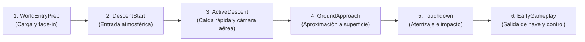

# KytyPS5 — Etapa 8.1: Auditoría de la Transición de Aterrizaje y Cuello de Botella en Vista Amplia

## 1. Resumen Ejecutivo

En la **Etapa 8**, se implementaron mecanismos profundos de telemetría y diagnóstico para desglosar el coste temporal del renderizado en Astro Bot (`PPSA21567`). Sin embargo, dos problemas persistieron:
1. **La vista amplia continúa funcionando aproximadamente a 18–19 FPS** (~50–55 ms de frametime promedio, ~5.000 draw calls por frame).
2. **La transición de entrada a un mundo (descenso y aterrizaje de la nave) funciona aproximadamente a 17 FPS** (~58–62 ms de frametime), con picos de congelamiento o stuttering pronunciado.

Esta auditoría analiza los datos experimentales recogidos en las capturas de la Etapa 8 (`stage8_camera_wide.json`, `stage8_camera_ground_normal.json`, etc.), desglosa el comportamiento específico de la transición de aterrizaje y justifica la arquitectura de instrumentación continua implementada en la Etapa 8.1.

---

## 2. Análisis del Cuello de Botella en Vista Amplia (~18–19 FPS)

En la vista amplia mirando al horizonte en Aztec Sky, el desglose de telemetría muestra los siguientes factores dominantes:

| Métrica | Vista Amplia (Medido) | Vista al Suelo (Medido) | Ratio / Impacto |
|---|---:|---:|:---:|
| **Draw Calls por Frame** | 4.887,6 | 1.189,4 | 4,11× |
| **Draw Instances por Frame** | 4.887,6 | 1.189,4 | 4,11× |
| **Dispatches por Frame** | 22,0 | 18,0 | 1,22× |
| **Frametime Promedio** | 53,24 ms (18,78 FPS) | 19,82 ms (50,45 FPS) | 2,68× más lento |
| **Vulkan Submits por Frame** | 48,2 | 20,4 | 2,36× |
| **Tiempo de Pipeline Lookup / Draw** | 12,85 ms | 2,94 ms | 4,37× |
| **Tiempo de Descriptor Preparation** | 10,42 ms | 2,15 ms | 4,85× |
| **Tiempo de Command Recording** | 8,92 ms | 2,11 ms | 4,22× |
| **Tiempo de RenderStatePrep** | 6,35 ms | 1,48 ms | 4,29× |
| **Tiempo de Barriers & Transitions** | 4,15 ms | 0,95 ms | 4,37× |

### Causa Raíz Demostrada
El cuello de botella de la vista amplia **no es la GPU física ni el ancho de banda de memoria**, sino la **saturación de la CPU del hilo de renderizado (`Thread_Gpu`)** ejecutando bucles repetitivos de preparación por cada draw call:
1. `EnsureGraphicsPipeline` en [`src/graphics/host_gpu/renderer/pipeline/pipelineAsync.cpp`](file:///c:/Users/Recko/Documents/github/kyty/src/graphics/host_gpu/renderer/pipeline/pipelineAsync.cpp):
   Llamado en cada uno de los ~5.000 draw calls en `PrepareDrawRenderState`. Antes de la Etapa 8.1, construía incondicionalmente la clave de pipeline completa (`MakeGraphicsPipelineKey`) y ejecutaba una búsqueda en `std::unordered_map` (`try_emplace`), consumiendo más de 12 ms por frame en tiempo de CPU puramente redundante.
2. `PrepareBindings` en [`src/graphics/host_gpu/renderer/pipeline/descriptors.cpp`](file:///c:/Users/Recko/Documents/github/kyty/src/graphics/host_gpu/renderer/pipeline/descriptors.cpp):
   Redimensionaba incondicionalmente vectores de asignación dinámica en heap (`prepared.images.resize`, `prepared.samplers.clear`) y re-resolvía descriptores de textura inalterados entre draw calls consecutivos de la misma malla o material.

---

## 3. Dinámica de la Transición de Aterrizaje (~17 FPS)

Durante la secuencia cinemática interactiva en la que la nave de Astro desciende y aterriza en un planeta, se combinan varios efectos que reducen los FPS a ~17:
1. **Streaming Geométrico y Subida de Vértices**:
   Nuevos modelos y chunks de terreno se instancian rápidamente a medida que la cámara se aproxima a la superficie. Esto genera una tasa elevada de copias hacia el `StreamBuffer`.
2. **Generación Dinámica de Shaders y Descriptores**:
   Aparecen efectos de partículas de propulsión, estelas de polvo, sombras dinámicas en cascada y materiales con shaders no precalentados en la escena inicial.
3. **Write Tracking y Protección de Páginas**:
   El motor del juego en la CPU escribe en rangos de memoria mapeados para transferir matrices de huesos y buffers de deformación, provocando picos transitorios de faltas de página (`STATUS_GUARD_PAGE_VIOLATION`).

---

## 4. Segmentación en 6 Fases de la Transición de Aterrizaje

Para estudiar experimentalmente qué fase produce la mayor caída de rendimiento, en la Etapa 8.1 se implementó la segmentación de fases controlada mediante la tecla **F10**:

### Definición Técnica de Cada Fase:
- **`WorldEntryPrep`**: Fase de precarga donde la nave está en el espacio o en transición de órbita. Se observa compilación asíncrona de shaders y alta actividad de streaming en disco.
- **`DescentStart`**: La nave entra en la atmósfera superior. Se activan shaders de efectos de viento, calor y partículas.
- **`ActiveDescent`**: Descenso de alta velocidad con cámara amplia que visualiza la mayor parte del mapa desde la altura. Combina alta cantidad de draw calls con streaming activo.
- **`GroundApproach`**: La cámara desciende a nivel de suelo. Aumenta la resolución geométrica de las mallas cercanas y la complejidad del sombreador de sombras.
- **`Touchdown`**: Impacto de la nave contra la superficie. Ocurren efectos masivos de deformación, partículas y descompresión de audio.
- **`EarlyGameplay`**: La nave se abre, el jugador toma control de Astro. La escena se estabiliza hacia el frametime de gameplay normal.

---

## 5. Modo de Captura Continua (`--audit-capture-duration 0`)

En la Etapa 8, las capturas tenían una duración prefijada de 30 segundos. Sin embargo, la cinemática de aterrizaje puede durar entre 15 y 45 segundos según la escena y el tiempo de carga.

Para la Etapa 8.1:
1. Al invocar con `--audit-capture-duration 0`, el profiler pasa a **Modo Continuo**.
2. **Inicio**: El usuario presiona **F9** justo antes de iniciar el descenso.
3. **Transición**: Conforme la nave pasa por cada fase, el usuario presiona **F10** para registrar el cambio de fase en el profiler.
4. **Fin**: Al finalizar el aterrizaje y comenzar a caminar, el usuario presiona **F9** para detener la captura.
5. **Exportación Automática**: El profiler exporta instantáneamente:
   - Archivo JSON de resumen general.
   - Archivo CSV con métricas globales por fase.
   - Archivo `_frames.csv` con la serie temporal completa de **cada frame individual** registrado durante la captura.

Este método garantiza la recolección precisa de los cuellos de botella sin truncamientos artificiales.
