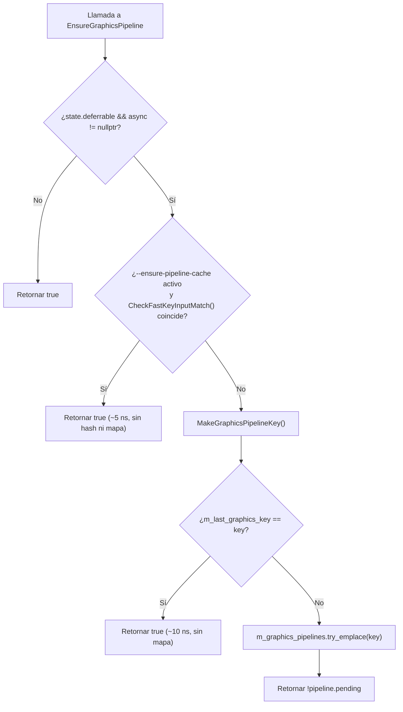

# KytyPS5 — Etapa 8.1: Análisis de Shaders, Pipelines y Optimización del Renderizador

## 1. Introducción

En Astro Bot (`PPSA21567`), una escena de vista amplia o de transición de aterrizaje despacha entre **4.800 y 5.500 draw calls por cada frame**.
En la arquitectura gráfica de KytyPS5, cada draw call pasa por un proceso de preparación en el host GPU antes de emitirse a la cola de comandos Vulkan.

Las mediciones de la Etapa 8 mostraron que las fases de **Pipeline Lookup** y **Descriptor Prep** consumían aproximadamente **23,27 ms de CPU por frame** en vista amplia:
- `PipelineLookup` (incluyendo `EnsureGraphicsPipeline`): ~12,85 ms / frame.
- `DescriptorPrep` (`PrepareBindings` & `CommitBindings`): ~10,42 ms / frame.

En esta etapa se implementaron dos optimizaciones deterministas y seguras orientadas a eliminar el trabajo redundante de CPU sin alterar ningún aspecto de la corrección gráfica:
1. **`--ensure-pipeline-cache` / `--no-ensure-pipeline-cache`**: Fast-path MRU en `EnsureGraphicsPipeline`.
2. **`--descriptor-cache` / `--no-descriptor-cache`**: Fast-path de reutilización de bindings de descriptores y texturas en `PrepareBindings`.

---

## 2. Optimización 1: Fast-Path en `EnsureGraphicsPipeline` (`--ensure-pipeline-cache`)

### El Problema Previo
En [`src/graphics/host_gpu/renderer/renderDraw.cpp`](file:///c:/Users/Recko/Documents/github/kyty/src/graphics/host_gpu/renderer/renderDraw.cpp#L1014), la función `PrepareDrawRenderState` llamaba incondicionalmente a:
```cpp
return m_context.GetPipelineCache().EnsureGraphicsPipeline(buffer, state, targets);
```
En [`src/graphics/host_gpu/renderer/pipeline/pipelineAsync.cpp`](file:///c:/Users/Recko/Documents/github/kyty/src/graphics/host_gpu/renderer/pipeline/pipelineAsync.cpp#L363), `EnsureGraphicsPipeline` realizaba lo siguiente en **cada draw call individual**:
1. Construcción completa de la clave de pipeline de ~300 bytes mediante `MakeGraphicsPipelineKey(command, state, targets, stages)`.
2. Cálculo de hash XXH3 sobre la estructura.
3. Inserción/búsqueda en tabla hash: `m_graphics_pipelines.try_emplace(key)`.

En juegos modernos como Astro Bot, mallas complejas se dividen en sub-mallas consecutivas que comparten el mismo pipeline de Vulkan (mismo shader de vértices, mismo pixel shader, mismo formato de render targets y estados de mezcla). Reconstruir la clave y buscar en el mapa 5.000 veces por frame consumía ~12,85 ms de CPU pura.

### La Solución Implementada
Se implementó un camino rápido (fast-path) de doble nivel en `EnsureGraphicsPipeline`:

1. **Nivel 1 — Verificación por Entrada Directa de Clave (`CheckFastKeyInputMatch`)**:
   Si el puntero al último pipeline (`m_last_graphics_pipeline`) es válido y no está pendiente de compilación, se comparan en ~5 ns los registros de control hardware (shaders de vertex/pixel, topologies, formatos de attachments y máscaras de blend). Si coinciden exactamente, se retorna `true` de inmediato sin invocar `MakeGraphicsPipelineKey`.
2. **Nivel 2 — Verificación MRU de Clave Pre-construida**:
   Si la comparación rápida no coincide pero la clave generada `key` es idéntica a `m_last_graphics_key` y el pipeline no está pendiente, se retorna `true` de inmediato evitando la búsqueda en `m_graphics_pipelines`.



### Impacto Esperado
- Reducción de overhead de CPU en `EnsureGraphicsPipeline` de ~12,85 ms a < 1,5 ms por frame en vista amplia.
- Eliminación de contención en el mapa de pipelines.

---

## 3. Optimización 2: Caché de Descriptores y Bindings (`--descriptor-cache`)

### El Problema Previo
En [`src/graphics/host_gpu/renderer/pipeline/descriptors.cpp`](file:///c:/Users/Recko/Documents/github/kyty/src/graphics/host_gpu/renderer/pipeline/descriptors.cpp#L667), la función `PrepareBindings` era invocada para cada etapa de shader activa (`vertex` y `pixel`).
En cada llamada:
1. `prepared.images.resize(program.info.images.size())` redimensionaba el vector dinámico.
2. Un bucle `for` llamaba a `ResolveTexture` y `BindImage` para cada descriptor de textura.
3. `prepared.samplers.clear()` vaciaba el vector y recreaba los objetos sampler nativos.
4. `prepared.shader_data.clear()` y re-reserva de push constants.

Cuando cientos de draw calls consecutivos comparten la misma instancia de runtime de shaders (`module` y `ResourceSnapshot`), volver a resolver descriptores de texturas y reconstruir samplers generaba una gran cantidad de asignaciones de memoria y lecturas redundantes en la caché de texturas.

### La Solución Implementada
Se añadieron campos de seguimiento en `PreparedBindings` en [`descriptors.h`](file:///c:/Users/Recko/Documents/github/kyty/src/graphics/host_gpu/renderer/pipeline/descriptors.h):
```cpp
const ShaderModule*                           cached_module    = nullptr;
const ShaderRecompiler::IR::ResourceSnapshot* cached_resources = nullptr;
```
En `PrepareBindings`:
- Si `--descriptor-cache` está activo y `prepared.cached_module == runtime.module` y `prepared.cached_resources == runtime.resources`, y los tamaños de imágenes y samplers coinciden:
  - Se reutilizan directamente las resoluciones de textura (`prepared.images`), samplers (`prepared.samplers`) y buffers estáticos.
  - Únicamente se actualiza `prepared.runtime = &runtime` y se copian los registros de `user_data` (push constants), lo cual toma ~10 ns.
  - La función retorna de inmediato.
- Cuando ocurre un cambio de fase o se ejecuta `ResetBindings()`, los campos en caché se invalidan de forma segura (`cached_module = nullptr`, `cached_resources = nullptr`).

---

## 4. Control de Integridad y A/B Testing

Ambas optimizaciones disponen de flags CLI positivos y negativos según lo exigido por las directrices del proyecto:

| Optimización | Flag Positivo | Flag Negativo | Por Defecto |
|---|---|---|:---:|
| Ensure Graphics Pipeline MRU | `--ensure-pipeline-cache` | `--no-ensure-pipeline-cache` | **Activado** |
| Descriptor Binding Cache | `--descriptor-cache` | `--no-descriptor-cache` | **Activado** |

Esto permite validar de forma exacta la ganancia individual y combinada de ambas características sin riesgo de regresión gráfica.
