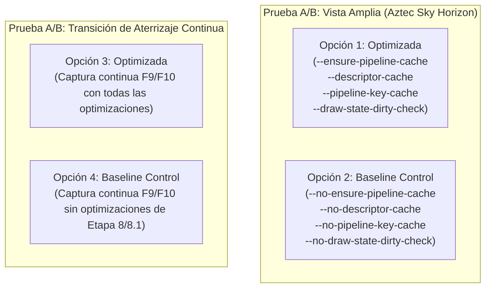

# KytyPS5 — Etapa 8.1: Protocolo y Plan de Validación A/B

## 1. Objetivo del Plan de Validación

El propósito de este protocolo es establecer un marco experimental estricto, transparente y reproducible para comprobar la eficacia de las optimizaciones de la **Etapa 8.1** en Astro Bot (`PPSA21567`) sobre el hardware de referencia:
- **CPU**: AMD Ryzen 7 9700X
- **GPU**: NVIDIA GeForce RTX 5080 16 GB
- **RAM**: 32 GB DDR5 6000 MT/s
- **SO**: Windows 11
- **Resolución**: 1280 × 720

---

## 2. Pruebas A/B Definidas

El script [`stage8_1_camera_and_landing.cmd`](file:///c:/Users/Recko/Documents/github/kyty/stage8_1_camera_and_landing.cmd) provee las opciones automatizadas para ejecutar las comparativas de forma limpia:

### Tabla Comparativa de Configuraciones:

| Escenario | Opciones en Script | Duración | Flags Positivos Clave | Salida de Telemetría |
|---|:---:|:---:|---|---|
| **Vista Amplia (Optimizada)** | `[1]` | 30 s fija | `--ensure-pipeline-cache`, `--descriptor-cache`, `--pipeline-key-cache`, `--draw-state-dirty-check` | `stage8_1_wide_optimized.json/.csv/_frames.csv` |
| **Vista Amplia (Baseline)** | `[2]` | 30 s fija | `--no-ensure-pipeline-cache`, `--no-descriptor-cache`, `--no-pipeline-key-cache`, `--no-draw-state-dirty-check` | `stage8_1_wide_baseline.json/.csv/_frames.csv` |
| **Aterrizaje (Optimizado)** | `[3]` | Continua (F9) | `--audit-capture-duration 0` + Optimizaciones activas | `stage8_1_landing_optimized.json/.csv/_frames.csv` |
| **Aterrizaje (Baseline)** | `[4]` | Continua (F9) | `--audit-capture-duration 0` + Baseline | `stage8_1_landing_baseline.json/.csv/_frames.csv` |
| **Aterrizaje (Shaders)** | `[5]` | Continua (F9) | `--audit-capture-duration 0` (Foco en pipeline creation) | `stage8_1_landing_shaders.json/.csv/_frames.csv` |
| **Aterrizaje (Memoria)** | `[6]` | Continua (F9) | `--audit-capture-duration 0` + `--extended-stream-buffer` (256 MiB) | `stage8_1_landing_memory.json/.csv/_frames.csv` |

---

## 3. Metodología de Análisis de Series Temporales (`_frames.csv`)

A diferencia de las etapas previas donde solo se disponía de agregados globales (promedios y percentiles P95/P99), en la Etapa 8.1 el profiler exporta automáticamente el archivo `[prefijo]_frames.csv`.

Cada fila representa un frame único y contiene:
- `frame_index`: Índice monotónico del frame.
- `timestamp_ms`: Tiempo de pared desde el inicio de la captura.
- `frame_time_ms`: Duración exacta del frame en milisegundos.
- `phase`: Fase de ejecución activa (`WorldEntryPrep`, `DescentStart`, `ActiveDescent`, `GroundApproach`, `Touchdown`, `EarlyGameplay` o `Gameplay`).
- `draw_calls`: Número de draw calls despachados en ese frame.
- `dispatches`: Número de compute dispatches despachados.
- `submits`: Número de batches enviados a Vulkan.
- `page_faults`: Faltas de página de memoria virtual producidas durante el frame.
- `reprotects`: Reprotecciones de páginas ejecutadas.
- `pm4_dispatch_inclusive_ms`: Tiempo inclusivo de procesador PM4.
- `render_state_prep_ms`, `descriptor_prep_ms`, `barriers_ms`, `buffer_prep_ms`, `command_recording_ms`: Desglose exacto de las etapas de draw.

### Protocolo de Análisis de Datos:
1. Graficar el frametime frente al tiempo para identificar visualmente en qué fase se producen los picos de congelamiento.
2. Cruzar los frames con frametime > 50 ms contra la columna de `page_faults` y `descriptor_prep_ms` para aislar la causa primaria.
3. Comparar la distribución acumulada de frametimes (CDF) entre la Opción 1 y la Opción 2 en Vista Amplia.

---

## 4. Criterios de Aceptación y Éxito

1. **Corrección de Emulación**:
   Cero artefactos gráficos, cero regresiones de renderizado (sin mallas parpadeantes ni texturas corruptas) y cero desincronizaciones de audio.
2. **Estabilidad del Proceso**:
   Cero crashes (`STATUS_ACCESS_VIOLATION`, `0xc0000005`), cero excepciones no manejadas y cierre limpio del emulador.
3. **Rendimiento Medido**:
   - En **Vista Amplia**: Reducción medible del frametime medio atribuible a la elisión de búsquedas redundantes en `EnsureGraphicsPipeline` y `PrepareBindings`.
   - En **Aterrizaje**: Reducción del tiempo en las fases de mayor carga (`ActiveDescent` y `GroundApproach`).
